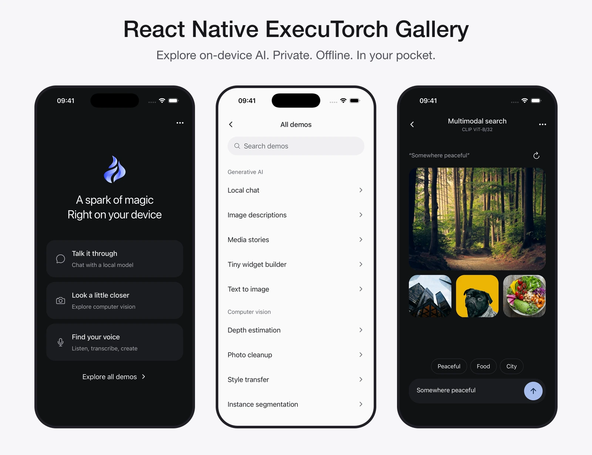
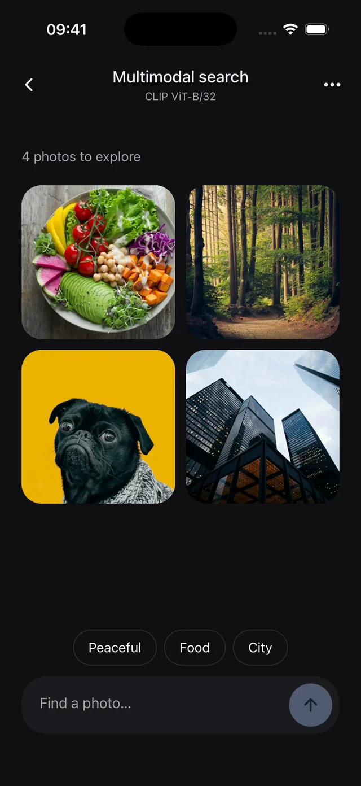
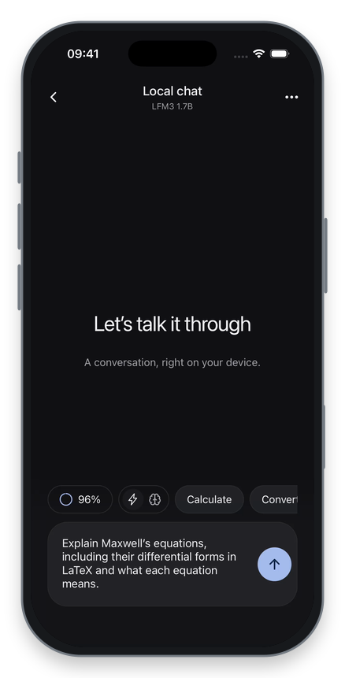
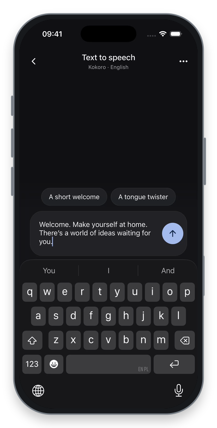

# React Native ExecuTorch Gallery

**React Native ExecuTorch Gallery** showcases on-device AI. Download models once, then run inference privately and fully offline on your device.



## In action

Recorded in the iOS simulator with models already loaded.

<details>
<summary><strong>Photo search</strong> — find a photo with words</summary>



</details>

<details>
<summary><strong>Local chat</strong> — generate a response on your device</summary>



</details>

<details>
<summary><strong>Text to speech</strong> — follow the words as they are spoken</summary>



</details>

## Demos

Explore the categories below. Each demo links to its screen implementation.

<details>
<summary><strong>Generative AI</strong> · 5 demos</summary>

- [Local chat](<src/app/(screens)/llm-chat.tsx>)
- [Image descriptions](<src/app/(screens)/image-description.tsx>)
- [Media stories](<src/app/(screens)/media-stories.tsx>)
- [Tiny widget builder](<src/app/(screens)/widget-builder.tsx>)
- [Text to image](<src/app/(screens)/text-to-image.tsx>)

</details>

<details>
<summary><strong>Computer vision</strong> · 9 demos</summary>

- [Depth estimation](<src/app/(screens)/depth-estimation.tsx>)
- [Photo cleanup](<src/app/(screens)/inpainting.tsx>)
- [Style transfer](<src/app/(screens)/style-transfer.tsx>)
- [Instance segmentation](<src/app/(screens)/instance-segmentation.tsx>)
- [Pose estimation](<src/app/(screens)/keypoint-detection.tsx>)
- [Text recognition](<src/app/(screens)/ocr.tsx>)
- [Semantic segmentation](<src/app/(screens)/semantic-segmentation.tsx>)
- [Object detection](<src/app/(screens)/object-detection.tsx>)
- [Image classification](<src/app/(screens)/image-classification.tsx>)

</details>

<details>
<summary><strong>Real time</strong> · 1 demo</summary>

- [Live object detection](<src/app/(screens)/realtime-object-detection.tsx>)

</details>

<details>
<summary><strong>Audio & speech</strong> · 3 demos</summary>

- [Text to speech](<src/app/(screens)/text-to-speech.tsx>)
- [Speech to text](<src/app/(screens)/speech-to-text.tsx>)
- [Voice activity detection](<src/app/(screens)/voice-activity-detection.tsx>)

</details>

<details>
<summary><strong>Embeddings & search</strong> · 2 demos</summary>

- [Multimodal search](<src/app/(screens)/image-embeddings.tsx>)
- [ColBERT retrieval](<src/app/(screens)/colbert-retrieval.tsx>)

</details>

<details>
<summary><strong>Natural language processing</strong> · 2 demos</summary>

- [Privacy filter](<src/app/(screens)/privacy-filter.tsx>)
- [Translation](<src/app/(screens)/translation.tsx>)

</details>

## Getting started

Requirements: Node.js 24 and npm. Git/source builds also use Corepack for the library’s pinned Yarn version. Native builds require Xcode 26.4 or newer for iOS, or Android Studio and Java 17 for Android.

```bash
nvm use
corepack enable
npm run deps:sync
npm run ios        # or npm run android
```

The app uses Expo SDK 57 and React Native 0.86, targeting iOS 17+ and Android 13+. It requires a native build; Expo Go is not supported.

## Choosing the library version

[`executorch.json`](executorch.json) records the selected source. The default is a pinned Git revision, so a fresh checkout can restore the same library without a sibling repository or submodule.

```bash
npm run deps:status                    # Show the selection and installed version
npm run deps:sync                      # Restore the recorded choice
```

Choose a published release:

```bash
npm run deps:use -- npm latest
```

Replace `latest` with an exact published version or another npm dist-tag. Tags resolve to an exact version before installation.

Choose cutting-edge source:

```bash
npm run deps:use -- git main
```

A branch, tag, or commit is accepted. The resolved commit is saved; `deps:sync` reuses that pin. Run the selection command again to update a moving branch. Git builds use the source repository's pinned Yarn and a managed checkout in the ignored `.executorch/` directory.

Use an existing monorepo while developing the library:

```bash
npm run deps:use -- local ../react-native-executorch
# Existing shortcut:
npm run deps:local
```

Local mode builds the working tree, including uncommitted changes. Before sharing a version change, choose a published release or a Git revision that CI can fetch. The selector never switches or resets your editable library checkout.

Commit `executorch.json`, `package.json`, and `package-lock.json` together after changing the selection, and rebuild the native app. The chosen library must support the APIs used by this gallery revision.

Source builds are packed into content-addressed `.local-packages/*.tgz` files, exercising the package's exports, postinstall, and native autolinking. These snapshots are ignored by Git: run `deps:sync` on a fresh checkout to restore the recorded archive and perform a frozen `npm ci` installation. Sync fails rather than rewriting the dependency selection if a rebuilt archive differs. Library source is a snapshot, not a live symlink. The package's `nativeLibsVersion` selects its prebuilt ExecuTorch binaries; building the underlying C++ runtime is a separate workflow.

## Development and testing

```bash
npm start               # Metro for an installed development build
npm run check           # All fast checks used in CI
npm test                # Version-selector regression tests
npm run typecheck
npm run lint
npm run format:check
```

Lefthook installs pre-commit checks with the dev dependencies. If hooks were skipped,
run `npm run hooks:install`. Hooks check formatting without modifying staged files.

To rebuild the README media from local captures (FFmpeg and img2webp are required):

```bash
npm run media:banner     # .artifacts/showcase/screenshots/{home,tasks,search}.png
npm run media:showcase   # .artifacts/showcase/recordings/{chat,speech,search}.mp4
```

For native release builds and model/device checks,
see [Verification](.agents/skills/gallery-verification/SKILL.md). CI builds Android and iOS
release binaries on pull requests ready for review without signing credentials.
Draft pull requests skip CI; marking them ready starts the checks and builds.

## Documentation

Library guides and API references: **[docs.swmansion.com/react-native-executorch](https://docs.swmansion.com/react-native-executorch/)**.

## Created by Software Mansion

Since 2012, [Software Mansion](https://swmansion.com) has been building mobile and web apps, contributing to open-source software, and working on React Native as Core React Native Contributors. We can help you build your next AI product — [Hire us](https://swmansion.com/contact?utm_source=react-native-executorch-gallery&utm_medium=readme).

[](https://swmansion.com)
